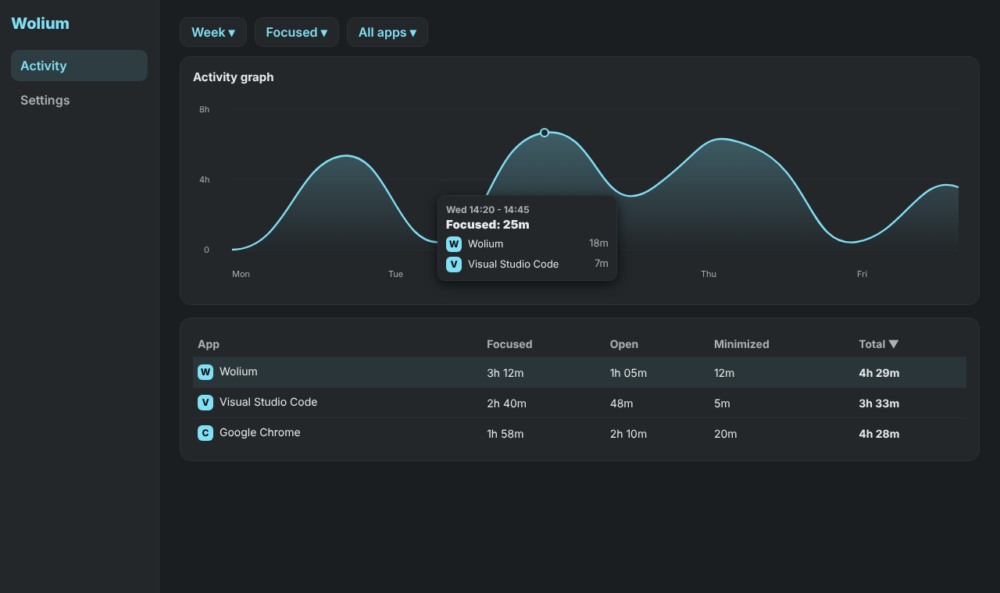

# Wolium

**Private activity tracker. Your data stays on your device.**

## What it does

Wolium shows how much time you spend in each app: a zoomable activity graph, a per-app table and CSV export. Nothing is recorded until you accept the privacy policy, and nothing leaves your device.

## Install

**Windows 10 / 11.** Run `WoliumSetup.exe`. Windows SmartScreen may warn about an unknown publisher: choose *More info*, then *Run anyway*. Wolium is not code-signed yet.

**Android 8+.** Open `Wolium.apk` and allow installing from this source. On first start grant *Usage access* to Wolium. Android only keeps about a week of history, so open the app at least once a week to keep your statistics complete.

**Linux (X11 / XWayland).** Extract the archive and run `./install.sh`. Windows of pure Wayland apps are not visible to the tracker.

## Using the graph

| Action | Mouse | Touch |
| --- | --- | --- |
| Zoom | wheel | pinch |
| Pan | drag | drag |
| Reset | middle or double click | double tap |
| Details | hover the line, click to pin | tap |

## Platform differences

| | Windows | Linux | Android |
| --- | --- | --- | --- |
| Focused / open / minimized / background | yes | yes | focused only |
| Auto-update | yes | no | no |
| Local API, Discord activity | yes | no | no |

## Privacy

Data is stored in a local SQLite file. On Windows it is `%LOCALAPPDATA%\DTSys\Wolium`, on Linux `~/.local/share/DTSys/Wolium`. Updating never touches it, uninstalling asks first. Policy: https://wolium.netlify.app/privacy-policy/

## License

Proprietary, see [LICENSE](LICENSE). Contributions: see [CONTRIBUTING.md](CONTRIBUTING.md).
