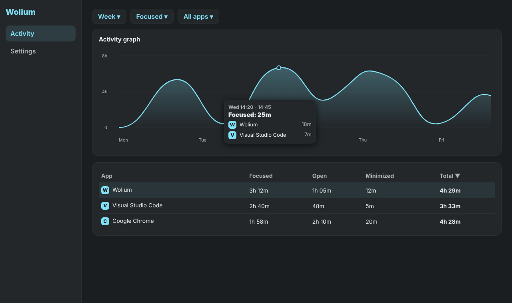

# Wolium

**Private activity tracker. Your data stays on your device.**

## What is Wolium

Wolium shows how much time you spend in each app: an interactive activity graph, a per-app table, daily leader, hidden apps and CSV export. Nothing is recorded until you accept the privacy policy, and nothing leaves your device.

## Install

| Platform | Steps |
| --- | --- |
| Windows 10 / 11 | Run `WoliumSetup.exe`. SmartScreen may warn about an unknown publisher: choose *More info*, then *Run anyway*. |
| Android 8+ | Open `Wolium.apk`, allow installing from this source, then grant *Usage access* on first start. |
| Linux | Extract the archive and run `./install.sh`. Windows are tracked on X11 and XWayland, and natively on Hyprland and Sway. On GNOME and KDE Wayland only background time is shown for pure Wayland apps. |
| macOS 11+ | Open `Wolium-macos.dmg` and drag Wolium to Applications. On first start right-click it and choose *Open*. No Screen Recording or Accessibility access is needed. |

Wolium is not code-signed, which is why Windows and macOS show a warning on first start. Every release ships `SHA256SUMS.txt` and a GitHub build attestation proving the file was built from this repository. To verify a download:

    gh attestation verify WoliumSetup.exe --repo arturwo1/trackwolium

## Features

- Activity graph: zoom, pan, tooltips with per-app time and sessions down to seconds
- Time per app in four states: focused, open, minimized, background (Android: focused only)
- Date ranges: day, week, month, year or any custom period
- Hide apps you do not want to see; restore them in Settings
- CSV export and, on Android, backup and restore as a file
- Local API (all platforms) and Discord activity cards (desktop), both off by default
- Update notifications with one-click update
- Languages: English, Russian

| Graph control | Mouse | Touch |
| --- | --- | --- |
| Zoom | wheel | pinch |
| Pan | drag | drag |
| Reset | middle or double click | double tap |
| Details | hover the line, click to pin | tap, or long press and drag |

## Platform differences

| | Windows | Linux | macOS | Android |
| --- | --- | --- | --- | --- |
| Focused / open / minimized / background | yes | yes | yes | focused only |
| Update notification | yes | yes | yes | yes |
| Local API | yes | yes | yes | yes (foreground service, persistent notification) |
| Discord activity, Discord restart button | yes | yes | yes | no |

## Android

Wolium collects statistics in the background every few hours without a permanent service, so you never need to open the app to keep the history complete. Android keeps only about a week of raw usage events, so open Wolium at least once a week if your phone is aggressive about killing background work.

## Privacy

Data is stored in a local SQLite file and never uploaded.

| Platform | Data folder |
| --- | --- |
| Windows | `%LOCALAPPDATA%\DTSys\Wolium` |
| Linux | `~/.local/share/DTSys/Wolium` |
| macOS | `~/Library/Application Support/DTSys/Wolium` |
| Android | app storage, included in Android's own backup when enabled |

Updating never touches your data, uninstalling asks first. Policy: https://wolium.netlify.app/privacy-policy/

## License

Proprietary, see [LICENSE](LICENSE). Contributions: see [CONTRIBUTING.md](CONTRIBUTING.md).
